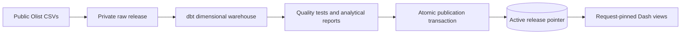

# RevenueIQ
### E-Commerce Revenue & Customer Intelligence

[](https://github.com/LouisHart1808/RevenueIQ/actions/workflows/ci.yml)

An end-to-end local analytics platform built from real historical Olist marketplace data: Python ingestion, PostgreSQL, dbt, nine interactive Plotly Dash views, and an evidence-based executive report.

**Business question:** Where does merchandise value come from, which customers return, where do delivery outcomes differ, and which opportunities deserve further testing?


[Walkthrough guide](docs/walkthrough.md) · [Recorded demo](reports/walkthrough.webm) · [Executive report](reports/executive_report.md) · [Architecture](docs/architecture.md) · [Metrics](docs/metrics.md) · [Validation methodology](docs/validation_methodology.md)

## What the evidence says
- **96,478 delivered orders**, **93,358 purchasing customers**, **R$13,221,498.11 merchandise value** and **R$137.04 AOV**. These are not recognized accounting revenue or profit.
- **3.00%** observed repeat purchase rate; predictive CLV is weakly supported by this sample.
- **93.23%** on-time delivery among eligible dated delivered orders.
- A single-seller sensitivity analysis finds a **−2.038-point** review-score difference for late deliveries, with a two-way customer/seller-clustered 95% interval of approximately **[−2.086, −1.990]**. Association does not establish causation.
- The development-selected forecast has approximately **14.79% WAPE** on the locked final three months. Its nominal 95% empirical band covers only **one of three months**. Poor uncertainty calibration is reported explicitly.
- **No basket pair passes the declared later-period replication rule.** A high lift alone is insufficient evidence for a recommendation.

Numbers are calculated from the source data and reproduced in [analytical outputs](reports/analytics.json). The dataset was already explored in the initial project: the new holdout is a retrospective separation of selection and evaluation, not never-viewed external evidence.

## Architecture


**Python 3.11–3.13 · PostgreSQL · dbt Core · pandas · Plotly Dash · SciPy · statsmodels · Docker Compose · pytest · Playwright · Ruff.** Dependencies are locked in `uv.lock`.

Each refresh builds in private schemas. Only a complete validated warehouse and matching report directory can be published. In-flight requests retain their immutable release; new requests select the newly published version immediately. Cache keys include the release ID, and the browser checks for publication every 15 seconds without resetting inputs when nothing changed. Failed publication preserves the active release. Previous releases are retained for rollback.

The data model preserves order/item/payment/review grains. Each one-to-many fact is independently aggregated before joining orders. Customer analysis uses persistent `customer_unique_id`.

## Application
| View | Main capabilities |
|---|---|
| Executive Overview | Six KPIs, sales/orders, clickable categories and regions, as-of segments and delivery |
| Revenue Intelligence | Comparable growth, exact Shapley decomposition, Pareto, anomaly screening and clickable sellers |
| Customer Intelligence | Cutoff-aware RFM, acquisition, frequency/value/recency, cohort retention and cumulative observed value |
| Product Intelligence | Category trends, product server pagination, delivery/review comparison and later-period basket validation |
| Operations Intelligence | Delivery trends/percentiles, review distribution, state and seller investigation |
| Geographic Intelligence | Clickable state sales map, order-volume map, delivery, orders and AOV |
| Advanced Analytics | Development versus holdout forecasts, coverage, and clustered statistical evidence |
| Scenario Planning | Multiplicative customer/frequency/AOV assumptions and sensitivity |
| Data Quality & Methodology | Profiles, warnings, exclusions, semantic contracts and financial limitations |

Category/seller filters select **whole baskets containing the chosen entity**, keeping revenue breakdowns reconciled. Click a category, region or seller to apply its shared filter. Customer history includes only purchases and known deliveries through the selected cutoff; unknown or later deliveries are excluded. Cohort filters select acquisition orders, then follow the original cohort members through the cutoff. These customer populations can differ from retrospective final-status revenue populations. Advanced research uses its explicitly defined development/test samples.

## Run with Docker
Requirements: Docker with Compose and internet for initial dependencies, public source download and optional Plotly basemap resources. No paid service or Kaggle credentials were required for the verified download.

```sh
git clone https://github.com/LouisHart1808/RevenueIQ.git
cd RevenueIQ
docker compose build
docker compose up -d db
docker compose run --rm app python scripts/refresh.py
docker compose up -d app
```

Open **http://127.0.0.1:8050**. PostgreSQL binds localhost **55433**. Raw data/reports are mounted from the project; PostgreSQL uses a persistent volume. Credentials are local demo defaults, not a public-hosting security configuration.

```sh
# Publish a freshly validated data release without restarting the app
docker compose run --rm app python scripts/refresh.py
# Apply application-code changes
docker compose build
docker compose up -d --force-recreate app
# Tests against the published release
docker compose run --rm -e RUN_INTEGRATION=1 app pytest -q
# Restore a previous retained release; obtain its ID from publication history
docker compose run --rm app python scripts/rollback.py <release-id>
# Stop; retain data volume
docker compose down
```

## Native development
Requires uv, Python 3.11–3.13 and PostgreSQL binaries. For a new isolated cluster:

```sh
make setup
mkdir -p .local
initdb -D .local/postgres -A trust --no-locale -E UTF8
pg_ctl -D .local/postgres -l .local/postgres.log -o '-p 55432 -h 127.0.0.1 -k /tmp' start
createdb -h 127.0.0.1 -p 55432 revenueiq
make refresh
make run
```

For an existing cluster, start it without repeating `initdb`/`createdb`. Override `DATABASE_URL`, `PGHOST`, `PGPORT`, `PGUSER`, `PGPASSWORD` in the shell when needed. Native Python does not automatically load `.env`; Compose does. `make transform` uses the safe full refresh; direct dbt builds into the published facade are rejected. `make download-data`, `make load-data` and `make analyze` are development utilities; only `make refresh` publishes an app release.

## Verification
```sh
make lint
make test                         # database tests explicitly skip without opt-in
RUN_INTEGRATION=1 make test
.venv/bin/python scripts/browser_check.py  # running app; local Chrome or Playwright Chromium
.venv/bin/python -m scripts.benchmark
```

Tests cover reconciliation, future-data leakage, model-selection leakage, frozen uncertainty calibration, later-period candidate validation, clustered inference, and atomic publication/rollback during an in-flight request. Browser checks drive real chart clicks, filters, cohort selection, sliders, CSV download and mobile layout.

[GitHub Actions](https://github.com/LouisHart1808/RevenueIQ/actions/workflows/ci.yml) runs unit tests, a real-data private build/publication, database tests, browser acceptance and Docker build. [Browser evidence](reports/browser_validation.json) and [performance measurements](reports/performance.json) are retained. Performance results exclude browser paint and are not a production concurrency benchmark.

## Source and licensing
[Olist Brazilian E-Commerce Public Dataset](https://www.kaggle.com/datasets/olistbr/brazilian-ecommerce), nine tables, purchases September 2016–October 2018, **CC BY-NC-SA 4.0**. Raw CSVs and private database/release files are excluded from Git. [Source evaluation](docs/dataset_selection.md), [metadata](docs/source_metadata.json), [checksums](docs/data_manifest.json), [quality report](reports/data_quality.json).

Original code is MIT. Source data and applicable analytical derivatives retain attribution, noncommercial and share-alike obligations. This is not an official Olist product.

## Limits and future work
No cost/profit/CAC/ROAS or causal uplift is inferred. The historical sample has sparse repeats, incomplete endpoint periods, no status event log and possible review nonresponse. Forecast intervals are empirically under-calibrated; basket replication and clustered inference do not remove all dependence or selection bias.

The app is local, without authentication or internet-facing hardening. Release retention is manual; retained versions consume disk space. Product charts show the leading 200 products; product CSV exports include all matches. The product explorer supports literal category/ID search, ranked sorting, result counts and bounded pagination. Seller summary exports cap at 100. Dash's pinned table component emits a future-removal warning. Next work: external validation data, better calibrated uncertainty, safe retention policy, access control, and further page-specific query optimization.
