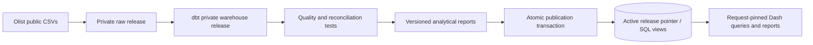

# Architecture and operational design

## Warehouse grains
Customer dimension: one order-linked customer_id, preserving persistent customer_unique_id. Product/seller dimensions: one source identifier. Geography: one state aggregate. Date: one calendar date. Orders and deliveries: one order. Items: (order_id, order_item_id). Payments: (order_id, payment_sequential). Reviews: one preserved source row, with a refresh-local surrogate ID. Item, payment and review facts are separately aggregated before joining order facts.

Marts cover month-level revenue, persistent-customer snapshots, month/category contribution, month/state operations and acquisition cohort/observed age. Static customer marts are audit summaries; interactive customer views use date-aware SQL.

## Atomic refresh
`scripts/refresh.py` acquires a PostgreSQL advisory lock and assigns a unique release ID. It loads a private raw schema, builds a private warehouse, runs dbt tests, analyzes planner statistics, and generates reports under `reports/releases/<release>/`. Failure leaves the active version unchanged and preserves stage logs for investigation.

Publication validates artifact presence, quality status, dbt results, and the exact validated model set. A single PostgreSQL transaction updates the `warehouse` compatibility views, records publication history, and changes the singleton active pointer. The first migration retains the old physical warehouse under a legacy schema. Published schemas and versioned reports are immutable. Portfolio convenience copies in `reports/` are not used by the application.

Every multi-query callback pins a release via a context variable. SQL references resolve to that immutable schema and reports resolve to its matching directory. A release published mid-request does not change that request's data. Subsequent requests read the new pointer immediately; process-local caches include the release ID, so workers need no TTL delay or restart. A 15-second browser poll changes the page only when the release changes; unchanged polls preserve selections and scenario inputs.

Rollback uses `python scripts/rollback.py <previous-release>` and the same validated publication transaction. Previous releases remain available for in-flight readers and recovery. Retention/garbage collection is deliberately manual; do not drop versions while requests may still reference them. There is no automatic disk-retention policy yet.

Direct dbt builds into the published `warehouse` facade are blocked. `make transform` invokes the safe full refresh. Raw source files and cached downloads may be refreshed, but published database schemas never read those mutable files.

## Date-aware customer semantics
Feature history includes orders purchased on/before the cutoff and delivered before the end of that day. Unknown or later delivery timestamps are excluded. Cutoff is capped at the source's last purchase date. Recency is cutoff + one day minus the last eligible purchase; frequency and monetary value use all eligible prior history.

Segment contribution describes customers active in the selected transaction window, labeled using those prior features. Cohort filters select acquisition orders within the date/state/category/seller filters; the fixed acquired population is then followed across all subsequent eligible purchases through the cutoff. This avoids selecting a cohort based on later survival. Future cells are absent, and partially observed endpoint months are flagged. Source timestamps are naive local values, so timestamp precision/timezone limitations remain.

Revenue KPIs remain retrospective final-status delivered merchandise, so customer history can exclude orders that revenue views include. This distinction is explicit; the source lacks an order-status event log for reconstructing every historical status.

## Application and performance
Parameterized SQL; category/seller membership through EXISTS; server-side product pagination; bounded summary tables. Clicks on category, region and seller charts update shared filters and provide a drill-down message. Units, currency and percentages are formatted consistently. Snapshot cache holds up to 64 release/filter combinations.

Customer history CTEs are explicitly NOT MATERIALIZED so PostgreSQL can use fact-table indexes. Published tables have statistics collected before release. Application queries have a 30-second statement timeout. The shared snapshot still loads multiple aggregate groups together; page-specific aggregate loading remains an optimization opportunity.

## Verification
Unit tests cover model-selection leakage, frozen interval calibration, future-only basket candidates, clustered uncertainty and validation failures. Integration tests check cutoff leakage, a promotion during an in-flight request, immediate cache-version changes and failed-promotion rollback in a disposable database. Browser acceptance covers real clicks, filters, cohorts, sliders, downloads and responsive layout. GitHub Actions runs these checks, a real-data atomic refresh and Docker build.

## Deployment boundary
Local bind addresses; no customer names or raw review text displayed. No authentication, tenancy or internet-facing hardening is provided. The application is intended for local portfolio use. Production work would add access control, independent external validation data, cluster-aware association research, stronger uncertainty calibration and safe release retention.
