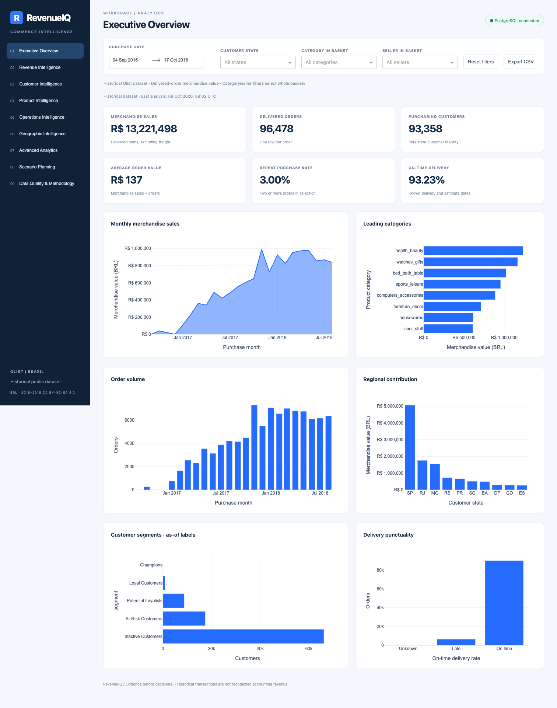

# RevenueIQ: a three-minute walkthrough

Open [the local application](http://127.0.0.1:8050) after following the README setup.

1. **Establish the business baseline.** On Executive Overview, explain that R$13.22 million is delivered merchandise value, not profit or recognized revenue. Observe the source's historical dates.
2. **Investigate a contributor.** Click a category bar. The category filter and basket-level KPIs update. Click a state or seller to narrow the population further, then reset filters. Category/seller filters select whole baskets.
3. **Travel back in time.** Set the end date to 30 June 2017 and open Customer Intelligence. RFM excludes purchases and deliveries after that day. Select a cohort; its retention and cumulative-value curve stops at the cutoff. Acquisition filters select original cohort members, not later survivors.
4. **Read evidence critically.** Reset filters and open Advanced Analytics. Contrast development scores with the locked final-period results and measured interval coverage. Explain why three test months cannot establish forecast reliability. Read the separate customer/seller-clustered delivery-review comparison.
5. **Check a product hypothesis.** Product Intelligence shows training-period associations and later-period evidence. A high lift is insufficient if the pair fails the replication count rule.
6. **Separate assumptions from observations.** On Scenario Planning, move customer growth to +1%. Projected merchandise value changes multiplicatively; no causal uplift or profit is implied.
7. **Explain reliability.** Data Quality & Methodology documents definitions and exclusions. A refresh builds in isolation, and the application switches only after validation. Failed publication leaves the previous release available.

Screenshots of all pages are in `reports/dashboard-01.png` through `dashboard-09.png`. [Watch the recorded walkthrough](../reports/walkthrough.webm). The recording drives the actual application and uses explanatory captions.
